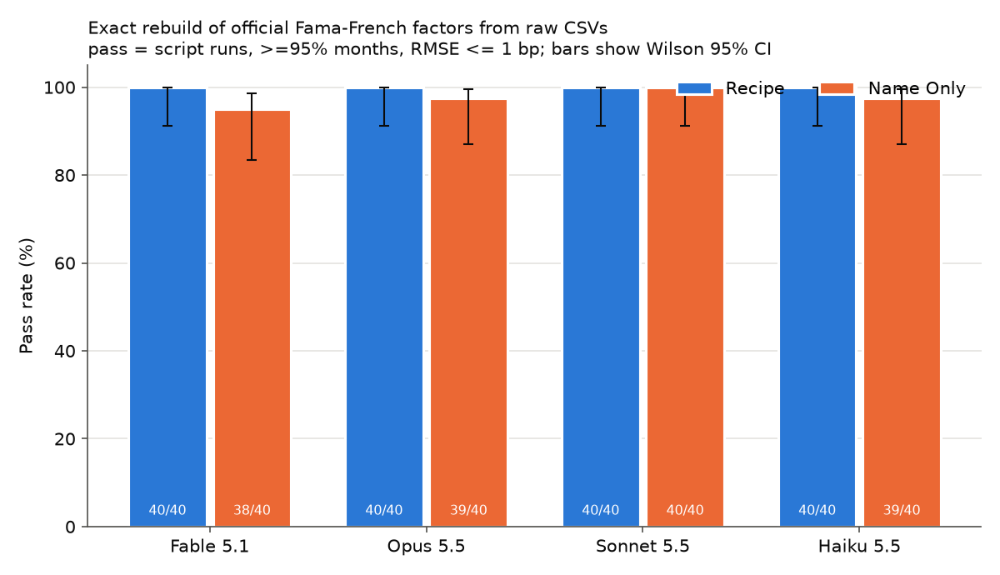

# Factor Forge

**Can frontier LLMs exactly rebuild the official Fama-French factors from Ken French's raw CSV files? And can they still get the inputs exactly right when they must click through a real website to find them?**

Part 1 built the answer key, Part 2 ran the file-based test (below), Part 3 (*Form Forge*) makes the models collect book equity through the SEC EDGAR web forms, and Part 4 is the analysis, write-up and talk (due Nov 11).

Course project for *Letting Claude Cook* (Harvard, Doug Finkbeiner) by Zaria Naqvi.
It follows up on my earlier *Replication Swarm* project. In that project Haiku, Sonnet and Opus all tied at rho = 0.945, because they were given pre-split files and only had to subtract two columns.

Here each model gets Ken French's raw portfolio CSVs as downloaded. Each file holds several stacked tables (value-weighted, equal-weighted, annual, firm counts and so on), and the model sees only the first 60 lines of each. It has to write one Python script that rebuilds a factor. The script's output is scored automatically against the official series French publishes.

| | |
|---|---|
| Factors (8) | HML, SMB (3-factor), SMB (5-factor), RMW, CMA, Mom, ST_Rev, LT_Rev (monthly) |
| Conditions | **RECIPE** (prompt gives the formula and the table) and **NAME_ONLY** ("construct HML exactly as Ken French does") |
| Models | claude-fable-5-1, claude-opus-5-5, claude-sonnet-5-5, claude-haiku-5-5, all at the same effort (`high`) |
| Repeats | 5 per cell, giving 8 x 2 x 4 x 5 = **320 runs** |
| PASS | the script runs, covers at least 95% of official months, and has **RMSE <= 1 bp** against the official series |
| Human reference | my rebuild (`ground_truth.py`) matches all 8 factors at RMSE 0.28-0.42 bp, which is rounding noise |

The scorer also tags each failed run with a cause: CRASH, NO_OUTPUT, BAD_FORMAT, WRONG_BLOCK (it used the equal-weighted table), SIGN_FLIP, UNITS (off by x100), DATE_MISALIGN, PARTIAL_COVERAGE or WRONG_FORMULA. Statistics are pass rates with Wilson 95% CIs and Fisher exact tests between adjacent models. The analysis also reports $ cost per correct answer.

## Reproduce Part 2 in 5 commands

```bash
python3 -m venv .venv && source .venv/bin/activate && pip install -r requirements.txt
cp .env.example .env && chmod 600 .env          # then paste your ANTHROPIC_API_KEY into .env
python run_experiment.py --repeats 5            # 320 API calls, resumable (rerun the same command after Ctrl-C)
python score.py                                 # writes results/runs_scored.csv
python analyze.py                               # writes results/summary.md and figures/*.png
```

You can test everything for free, with no API key: `python selftest.py`, then `python run_experiment.py --dry-run --repeats 2 && python score.py --dry-run && python analyze.py --dry-run`. A dry run uses a fake model that plants known mistakes, and the scorer has to catch each one.

## Part 2 files

| file | purpose |
|---|---|
| `ground_truth.py` | my parser and factor recipes. Builds `data/truth` (official) and `data/reference` (rebuilt) |
| `tasks.json` | the 8 tasks: input files, RECIPE and NAME_ONLY text, the pass rule, and the files the model must never get |
| `prompts.py` | builds the prompt. The wording is identical for every model (frozen as `prompts-v1`) |
| `run_experiment.py` | calls the API, extracts the script, runs it in a clean temp folder (60 s limit) and logs tokens, $ and latency |
| `score.py` | compares each output to the official series, then assigns PASS/FAIL and an error tag |
| `analyze.py` | pass-rate table with CIs, Fisher tests, cost per correct answer, figures and `summary.md` |
| `dryrun_mock.py`, `selftest.py` | the fake model and the scorer self-test (88 planted mistakes, plus timeout and API-key-leak checks) |

## Results (Part 2, full run 2026-10-26)

**316 of 320 runs passed (98.8%), for $11.16 in total.** All 160 RECIPE runs passed; 156 of 160 NAME_ONLY runs passed.

| model | passed | cost | $ per correct answer |
|---|---|---|---|
| claude-sonnet-5-5 | 80/80 | $1.22 | $0.015 |
| claude-haiku-5-5 | 79/80 | $0.13 | $0.002 |
| claude-opus-5-5 | 79/80 | $3.03 | $0.038 |
| claude-fable-5-1 | 78/80 | $6.78 | $0.087 |

The 4 failures were all coding slips, not finance mistakes:
- Fable MOM NAME_ONLY r2 and r4 (`BAD_FORMAT`): the header search `"LoPRIOR" in s.upper()` can never match, so the output had 0 rows.
- Haiku SMB_5F NAME_ONLY r5 (`WRONG_FORMULA`): columns picked with `startswith("SMALL")` missed "ME1 BM2", so each leg averaged 2 portfolios instead of 3.
- Opus RMW NAME_ONLY r3 (`CRASH`): under pandas 3, `to_numpy()` returned a read-only array.

**What it means:** the task was too easy to separate the models. H1 (bigger is better) is rejected: Sonnet was top. The test hit a ceiling. That is why Part 3 exists (below).

The figures come from `python analyze.py` (free, no API). It writes `figures/pass_rate.png` and `results/summary.md`.



## Notes on method (Part 2)

- **The models never see the answers.** The official factor files are never copied into the folder where a model's script runs.
- **Same conditions for every model.** Each run is a fresh API call: no system prompt, no tools, no web access. Temperature is left at the default, because these models reject sampling parameters. Effort is set to `high` for all four models, so the comparison is not confounded by different default efforts. No model fallbacks are used.
- **Prompts are frozen** (git tag `prompts-v1`) before the pilot. Any later change is logged in `notes.txt`. Each run stores the hash of its prompt.
- **Disclosure.** Claude Code helped build the harness, scorer and analysis code; that is the theme of the course. It never wrote or fixed the answers being evaluated. The human reference `ground_truth.py` was written with Claude's help and checked against French's official series.
- **Safety.** The scripts the models write run on my machine without an API key in their environment. This is not a full sandbox, so read a few scripts after the pilot.
- **Data.** Ken French Data Library, 202608 CRSP release, downloaded 2026-10-14.

---

# Part 3: Form Forge (harder: the models must click through SEC EDGAR)

**When the models must find the data themselves, by clicking through a real government website, do they still tie?**

Part 2 gave the models tidy file previews and they tied at 316/320. In Part 3 the model gets **no files and no Python**. It gets only a headless web browser, driven through 9 tools (goto, read_page, find_text, click, fill, select_option, press, back, submit_answer). It must click through **SEC EDGAR**, the way SkyServer makes you click through query forms for astronomy data: company search, then the filings list, then the filing index, then `FilingSummary.xml`, then the balance-sheet page. From there it reads **book equity** (the "B" in the B/M behind HML) from a 10-Q or 10-K **filed after July 1, 2026**, which is past every model's training cutoff.

The answer key comes from SEC's XBRL API (`data.sec.gov/api/xbrl`). The models' browser **cannot reach that API**, so they have to use the pages. Grading is exact (tolerance $0) and automatic, as in Part 2.

| | |
|---|---|
| Tasks (8) | T1 Apple, T2 Microsoft (a 10-K, not a 10-Q), T3 Walmart (excluding NCI), T4 Netflix ($ in thousands), T5 Domino's (a deficit, negative), T6 JPMorgan (common equity = total minus preferred), T7 Berkshire Hathaway (two-part balance sheet), T8 rank Apple, Coca-Cola, Chevron and 3M by B/M |
| Conditions | **STEPS** (the click path, row and column names and a units hint, like RECIPE) and **GOAL_ONLY** (the goal and general rules only, like NAME_ONLY) |
| Models | the same 4 as Part 2, all at effort `high` |
| Repeats | 3 per cell, giving 8 x 2 x 4 x 3 = **192 runs** (2 repeats, 128 runs, if the pilot says 192 would cost over $100) |
| PASS | the run ended with `submit_answer`, the value is the exact whole-dollar number, and the accession number is the original filing's (T8: all four values and the ranking exact) |
| Limits | 30 tool calls (50 for T8), 12 minutes, observations of at most 10,000 characters, at most 5 SEC requests per second |
| Budget | `--budget-usd 100`: the runner stops before a run that could push the total past $100 |

Failed runs get a tag: STEP_LIMIT, TIME_LIMIT, REFUSAL, GAVE_UP, UNGROUNDED (the number never appeared on any page it saw), WRONG_ENTITY, NAV_ERROR (never reached the filing), UNITS, SIGN, WRONG_PERIOD (comparative column), WRONG_LINE (e.g. equity including NCI), WRONG_FILING, ARITH or OTHER_WRONG. HARNESS_ERROR runs (site outage, SEC 403) are excluded and rerun.

Hypotheses H1-H5 and the full design are in [docs/06-part3-form-forge-design.md](docs/06-part3-form-forge-design.md).

## Reproduce Part 3

```bash
cd ~/letting-claude-cook/factor-forge && source .venv/bin/activate
pip install -r web/requirements-web.txt           # playwright 1.64.1
python -m playwright install chromium
# add to .env (your name + a contact address you choose; never commit .env):
#   SEC_USER_AGENT="Firstname Lastname contact@yourdomain"

# free checks (no API key, $0)
python web/answer_key.py --check                  # "frozen key matches a rebuild from raw files: True"
python web/selftest_web.py                        # "148/148 checks passed" / "ALL CHECKS PASSED"
python web/run_web.py --dry-run --tasks T1 T4 --conds STEPS --repeats 1 --out runs_web_mock   # fake model, live site
python web/score_web.py --runs runs_web_mock --out results_web_mock                          # "0 mismatches"
python web/capture_fixtures.py --all             # walks every STEPS path on the live site; each task "matches the key"

# pilot (real API, about $5-7)
python web/run_web.py --pilot --models haiku sonnet --tasks all --conds STEPS GOAL_ONLY --repeats 1 --out runs_web_pilot
python web/run_web.py --pilot --models fable opus --tasks T1 T4 --conds GOAL_ONLY --repeats 1 --out runs_web_pilot
python web/score_web.py --runs runs_web_pilot --out results_web_pilot

# main run (192 runs, resume-safe: rerun the same command after Ctrl-C)
caffeinate -i python web/run_web.py --models fable opus sonnet haiku --tasks all --conds STEPS GOAL_ONLY \
       --repeats 3 --effort high --budget-usd 100 --out runs_web 2>&1 | tee -a runlog_web.txt
python web/score_web.py --runs runs_web --out results_web
python web/analyze_web.py --in results_web/runs_scored.csv --part2 results/runs_scored.csv --out results_web
```

The step-by-step version, with dates and checkpoints, is in [docs/03-step-by-step-checklist.md](docs/03-step-by-step-checklist.md) (Steps 12-18). Each script is explained in `docs/code/09` to `docs/code/15`.

## Part 3 files (all in `web/`)

| file | purpose |
|---|---|
| `tasks_web.json` | the 8 tasks: goal text, STEPS click path, units hint, answer schema, step cap, frozen answers, T8 market equity |
| `answer_key.py` | fetches companyfacts + frames (11 requests) and freezes `answer_key.json` and `data/raw/` (sha256). `--check` re-verifies with no network |
| `prompts_web.py` | the system prompt and the STEPS / GOAL_ONLY prompt builder (`PROMPT_VERSION`) |
| `sec_policy.py` | allowed hosts, SEC robots.txt rules, the blocked XBRL API, at most 5 requests/s, the declared User-Agent, the asset cache, fixture record/replay |
| `browser_tools.py` | the Playwright browser and the 9 tools; pages become text with inline `[eN link]` refs, cut into 10,000-character chunks |
| `run_web.py` | the agent loop: tool use, prompt caching, step and time limits, per-step logs, cost, budget guard, resume |
| `mock_agent.py` | the fake model for `--dry-run`: 9 personas that plant known mistakes |
| `capture_fixtures.py` | saves the live pages once for offline tests (`web/fixtures/`) |
| `selftest_web.py` | policy, rate-limit, User-Agent, scorer, API-shape and offline end-to-end checks (no API, no network) |
| `score_web.py` | PASS plus an error tag, written to `runs_scored.csv` |
| `analyze_web.py` | Wilson CIs, Fisher tests (H1-H5), cost per correct answer, 3 figures, `summary.md` with the Part 2 vs Part 3 table |

## Results (Part 3)

**189 of 192 runs passed (98.4%, Wilson 95% CI [95.5, 99.5]), for $21.96 in scored runs** ($25.25 in the ledger, which includes the 10 sleep-affected originals). All 96 STEPS runs passed; 93 of 96 GOAL_ONLY runs passed.

| model | Part 2 | Part 3 | Part 3 cost | $ per correct answer |
|---|---|---|---|---|
| claude-fable-5-1 | 78/80 | 48/48 | $11.40 | $0.237 |
| claude-opus-5-5 | 79/80 | 48/48 | $4.80 | $0.100 |
| claude-sonnet-5-5 | 80/80 | 45/48 | $5.56 | $0.123 |
| claude-haiku-5-5 | 79/80 | 48/48 | $0.20 | $0.004 |

All 3 failures were Sonnet GOAL_ONLY runs, and none was a finance or navigation mistake:
- T4 Netflix r3 (`GAVE_UP`)
- T6 JPMorgan r2 and r3 (`STEP_LIMIT`)

No Fisher test is significant after Holm correction. Part 2 vs Part 3 for all models gives p_holm = 1.00. The lowest is Sonnet Part 2 vs Part 3: p = 0.051, p_holm = 0.71.

**What it means:** clicking through EDGAR did not separate the models either. Every model found exact book equity in post-cutoff filings almost every time. Haiku did it for $0.004 per correct answer.

**Sleep rerun (protocol deviation).** The first pass scored 179/192, with 10 `TIME_LIMIT` runs. In every one of those 10, the Mac was asleep for 89-100% of the stall, so they were not counted as model failures. Their folders were moved to `runs_web_sleep_affected/`. The 10 runs were redone on Nov 2 under `caffeinate -i`, with the same command and the same commit and no code change, and all 10 passed. The reruns happened out of the original repeat-major order. The pre-rerun scores are kept in `results_web/runs_scored_before_sleep_rerun.csv`, and the details are in `notes.txt`.

Full tables: `results_web/summary.md`. Figures: `results_web/fig_task_heatmap.png`, `fig_cost_per_correct.png`, `fig_steps_success.png`.

## Notes on method (Part 3)

- **The models cannot see the answer key.** `sec_policy.py` blocks `data.sec.gov/api/xbrl/*` for the browser. Each blocked try is counted (`blocked_attempts`).
- **SEC's rules are followed.** Every request sends the declared `SEC_USER_AGENT`, goes at most 5 per second (SEC allows 10), and obeys SEC's robots.txt (so `/cgi-bin` is blocked). Runs are one at a time.
- **How the browser reaches SEC.** When headless Chromium fetched SEC pages itself, SEC answered `403 Undeclared Automated Tool`. So every request is made by a plain HTTP client (`httpx2`) that sends only the declared User-Agent; Chromium only renders the pages. Nothing is disguised. If SEC still answers 403, the run is a HARNESS_ERROR and the whole session stops.
- **Same conditions for every model:** same system prompt, tools, limits, effort `high` and `max_tokens` 16,000 per turn. A fresh browser (no cookies) for every run.
- **Logs.** Each run folder keeps the prompt, every tool call (`steps.jsonl`), every page the model saw (`pages/`), every network request (`requests.jsonl`), the transcript and `final.json`. The User-Agent is stored only as a sha256.
- **Disclosure.** Claude Code built the Part 3 harness, key builder, scorer and tests on 2026-10-28, using a fake model only. It made no API calls and never chose the answers under test.
