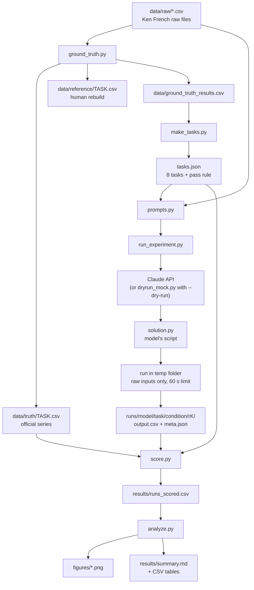

# 00 - How the pieces fit

Factor Forge tests whether Claude models can rebuild 8 official Fama-French factors (HML, SMB_3F, SMB_5F, RMW, CMA, MOM, ST_REV, LT_REV) from Ken French's raw portfolio CSV files. Each model writes a Python script. The harness runs the script and scores its output against the official series. PASS = the script runs, covers at least 95% of the official months, and has RMSE of at most 1 basis point.

8 tasks x 2 conditions (RECIPE, NAME_ONLY) x 4 models x 5 repeats = 320 runs.

## The flow



In words:

1. **Answer key.** `ground_truth.py` reads the raw CSVs and the official factor files. It saves the official series to `data/truth/` and its own rebuild to `data/reference/`, and shows the rebuild matches to within rounding (0.28 to 0.42 bp).
2. **Task list.** `make_tasks.py` uses those results to write `tasks.json`: the 8 tasks, the prompt text for both conditions, and the pass rule (1.0 bp).
3. **Prompts.** `prompts.py` turns a task and a condition into the exact prompt text, including the first 60 lines of each raw input file.
4. **Runs.** `run_experiment.py` sends each prompt to a model, extracts the script from the reply, runs it in a clean temp folder that holds only the raw input files, and saves everything.
5. **Scoring.** `score.py` compares each `output.csv` with `data/truth/` and gives PASS or an error tag.
6. **Analysis.** `analyze.py` makes the pass-rate tables, statistical tests, cost table, figures and summary.

`dryrun_mock.py` and `selftest.py` sit beside this chain. They test it for free with fake scripts that contain known mistakes.

The raw CSVs come from the zips in `data/zips/` (downloaded from the Ken French Data Library; the URL pattern is in `tasks.json`). No script in the project downloads them.

## The files at a glance

All commands are run from inside `~/letting-claude-cook/factor-forge` with the venv active (`source .venv/bin/activate`).

| file | what it does in one line | when you run it | command | what it reads | what it writes |
|---|---|---|---|---|---|
| `ground_truth.py` | Rebuilds the 8 factors by hand and checks them against French's official series | Once, after downloading data (again only if data changes) | `python -I ground_truth.py` | `data/raw/*.csv` | `data/truth/*.csv`, `data/reference/*.csv`, `data/ground_truth_results.csv` |
| `make_tasks.py` | Writes the task definitions and pass threshold | Once, after `ground_truth.py` | `python make_tasks.py .` | `data/ground_truth_results.csv` | `tasks.json` |
| `tasks.json` | The 8 tasks, prompt texts, answer paths, pass rule, forbidden files | Not run; a data file | (none) | (read by other scripts) | (written by `make_tasks.py`) |
| `prompts.py` | Builds the exact prompt for one task and condition | Imported by the harness; run by hand to inspect a prompt | `python prompts.py HML RECIPE` | `tasks.json`, `data/raw/*.csv` | nothing (prints the prompt) |
| `run_experiment.py` | Calls the models, extracts and runs their scripts, saves every run | For the pilot and the full experiment | `python run_experiment.py --repeats 5` (free test: add `--dry-run`) | `tasks.json`, `data/raw/*.csv`, `.env` | `runs/` (or `runs_dryrun/`): per-run folders and `manifest.json` |
| `dryrun_mock.py` | Fake model that returns correct or deliberately broken scripts | Never directly; used by `--dry-run` and `selftest.py` | (none) | nothing | nothing (returns text) |
| `selftest.py` | Plants every known mistake on every task and checks the scorer tags it right | Before any real run, and after changing the harness or scorer | `python selftest.py` | `tasks.json`, `data/raw/`, `data/truth/` | nothing kept (uses a temp folder); prints `90/90 checks passed` |
| `score.py` | Grades every run: PASS or an error tag | After runs finish (rerun any time) | `python score.py` (or `--dry-run`) | `runs/*/.../meta.json` and `output.csv`, `tasks.json`, `data/truth/`, `data/raw/` | `results/runs_scored.csv` (dry run also `dryrun_check.csv`) |
| `analyze.py` | Pass rates with CIs, Fisher tests, cost, figures, summary | After `score.py` | `python analyze.py` (or `--dry-run`) | `results/runs_scored.csv`, `tasks.json` | `results/pass_rates.csv`, `fisher_tests.csv`, `task_pass_rates.csv`, `cost.csv`, `error_tags.csv`, `summary.md`; `figures/pass_rate.png`, `task_heatmap.png`, `error_tags.png` |
| `requirements.txt` | Pins exact library versions | When setting up the venv | `pip install -r requirements.txt` | (none) | (installs packages into `.venv/`) |
| `.env.example` | Template for your API key | Once, at setup | `cp .env.example .env && chmod 600 .env` | (none) | `.env` (you paste the key) |
| `.gitignore` | Keeps secrets and throwaway outputs out of Git | Automatically, by Git | (none) | (none) | (none) |

## Full sequence

Free end-to-end test (no API key, no cost):

```bash
python selftest.py
python run_experiment.py --dry-run --repeats 2
python score.py --dry-run
python analyze.py --dry-run
```

Real experiment:

```bash
python run_experiment.py --models haiku --tasks HML --repeats 1   # tiny pilot
python run_experiment.py --repeats 5                               # 320 calls, resumable
python score.py
python analyze.py
```

## Per-file docs

- [01 - ground_truth.py](01-ground_truth.md)
- [02 - make_tasks.py and tasks.json](02-make_tasks-and-tasks-json.md)
- [03 - prompts.py](03-prompts.md)
- [04 - run_experiment.py](04-run_experiment.md)
- [05 - dryrun_mock.py and selftest.py](05-dryrun_mock-and-selftest.md)
- [06 - score.py](06-score.md)
- [07 - analyze.py](07-analyze.md)
- [08 - config files](08-config-files.md)
